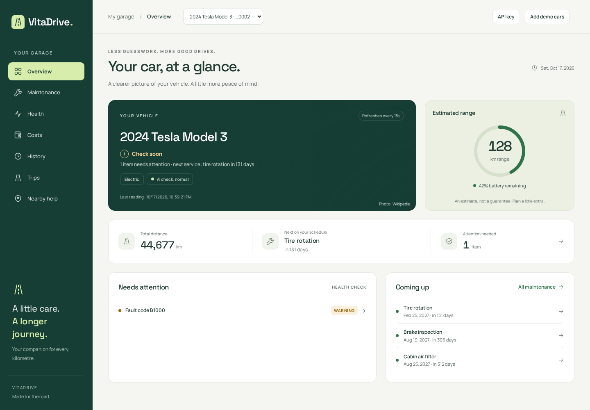
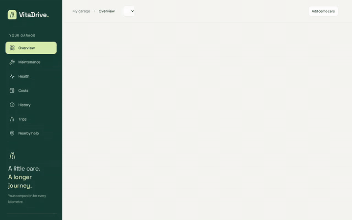
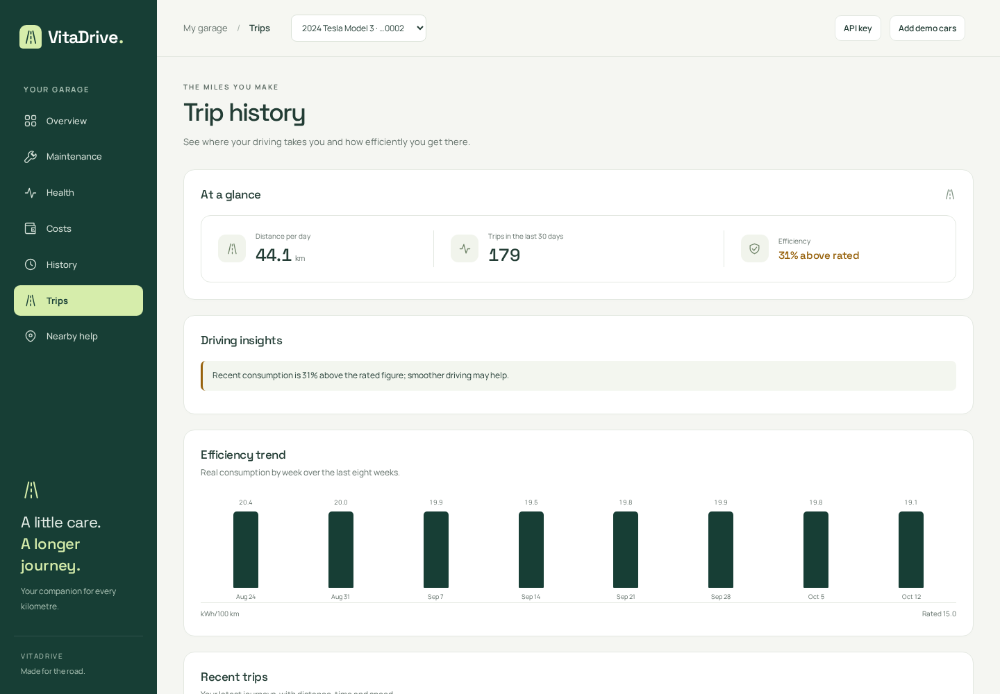
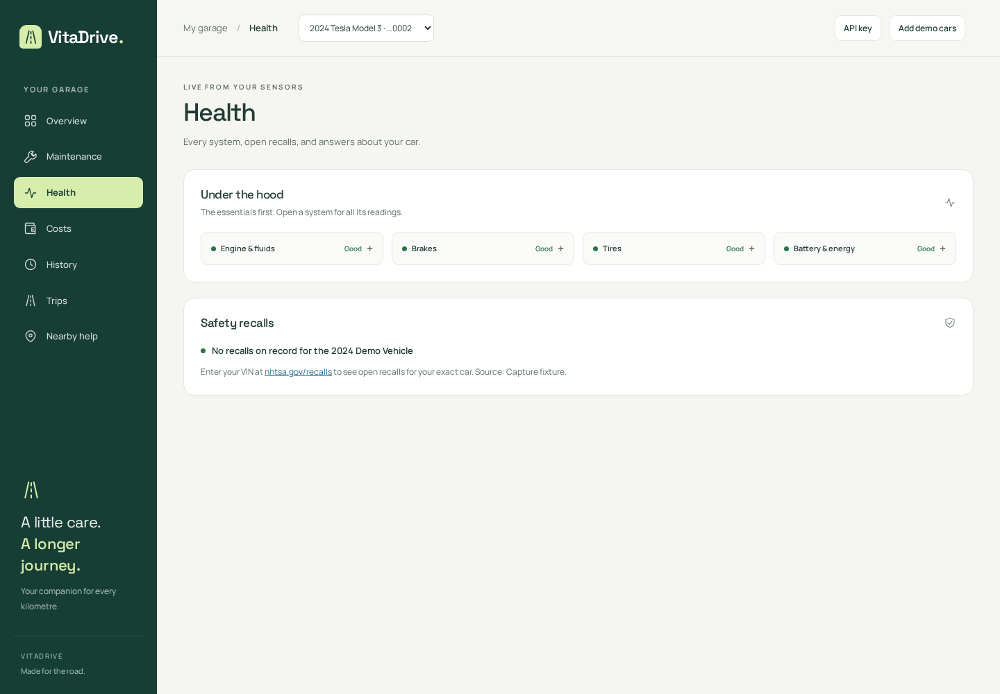
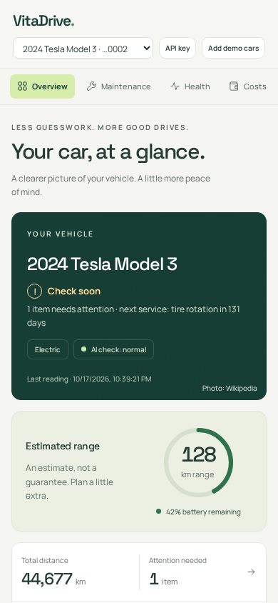
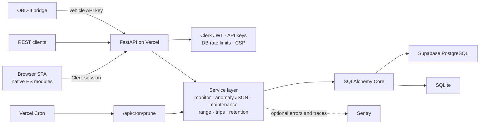

# VitaDrive

**Turn vehicle telemetry into clear health alerts, maintenance forecasts, range estimates, and trip history.**

[](https://github.com/adotak/vitadrive/actions/workflows/ci.yml)
[](https://github.com/adotak/vitadrive/actions/workflows/ci.yml)

**Live demo:** [vitadrive.vercel.app](https://vitadrive.vercel.app)





## What it does

- Monitors vehicle vitals and diagnostic codes, deduplicates alerts, and detects unusual combinations of sensor values.
- Forecasts maintenance, estimates driving range, and exports service reminders to a calendar.
- Records fuel and charging costs, detected trips (PR #11), and efficiency trends.
- Finds nearby help, checks US safety recalls, and can send critical alerts as Web Push notifications.
- Accepts readings from the REST API or the vehicle-side OBD-II bridge (PR #12), which buffers readings while offline.
- Supports Clerk accounts, per-vehicle ingest keys, SQLite for local use, and PostgreSQL for deployment.

The dashboard includes responsive **Trips**, **Health**, and Overview views:

| Trips | Health | Mobile Overview |
|---|---|---|
|  |  |  |

## Architecture



See [the architecture guide](docs/ARCHITECTURE.md) for the request lifecycle,
schema and migrations, authentication modes, retention, and configuration.

## Tech decisions

| Decision | Why | Trade-off |
|---|---|---|
| FastAPI | Typed request validation, OpenAPI, and one API that serves both the dashboard and REST clients. | Application behavior follows FastAPI/Starlette middleware and dependency semantics. |
| SQLAlchemy Core + Alembic | Explicit queries support SQLite and PostgreSQL; migrations make schema changes reproducible. | Schema changes and migration scripts require deliberate, manual review. |
| Database-backed rate limits | Counters are shared across short-lived Vercel instances. | Limited requests add database work and depend on database availability. |
| Daily summaries after 30 days | Keeps long-term sensor trends while bounding raw-reading growth. | Older samples are represented by daily aggregates, not individually retained readings. |
| Vanilla ES modules, no build | The static dashboard can be served directly without a bundler or generated assets. | Module boundaries and imports are maintained by hand; modern browser module support is required. |
| Anomaly model exported to JSON | Inference stays in plain Python without a PyTorch or NumPy runtime dependency. | Training is a separate PyTorch workflow and must export updated weights. |
| Clerk JWT authentication | Public JWKS verification scopes vehicle data to the signed-in owner without storing passwords. | Deployed environments must configure Clerk; auth-off mode is only for trusted local development. |
| Stdlib-only bridge with offline buffer | Runs beside the car, retries REST delivery, and keeps queued readings in local SQLite during outages. | The bridge must run continuously on a connected device and manage its local buffer. |
| Strict script CSP | External modules and delegated actions avoid allowing inline script execution. | New UI behavior must use external modules rather than inline scripts or handlers. |

## Quality

- Python CI runs on **3.10 and 3.12**, with Ruff, mypy, and SQLite/PostgreSQL tests.
- Coverage is measured with branch tracking and gated at **85%**.
- Playwright E2E tests cover browser navigation and core dashboard workflows.
- Lighthouse CI gates accessibility and best practices at **95**, and performance at **85**.
- Docker CI builds and starts the Compose stack, seeds demo data, and checks health and API responses.
- `pip-audit` checks dependencies; Dependabot proposes weekly Python and GitHub Actions updates.
- On this branch, `pytest --cov` reports **181 passed, 7 skipped; 89.21% total coverage** (85% required).

## Lessons learned

- Existing databases need careful Alembic adoption: a safe stamp can preserve compatible legacy data, while partial schemas must fail rather than be guessed at.
- In-memory rate counters do not coordinate across serverless instances, so shared limits belong in the database; that consistency costs a write on limited requests.
- A strict CSP exposed dashboard handlers that depended on inline `onclick` attributes. Native modules and delegated `data-action` events removed that script exception.
- Lighthouse surfaced contrast and third-party image findings. Anonymous image requests and a stronger muted-text token improved the audit without introducing a maps or image API key.
- Raw sensor readings can be compacted without erasing trip history because trips are persisted separately from daily reading summaries.

## Quick start

### Local

```bash
python -m venv .venv
source .venv/bin/activate
pip install -e ".[dev]"
vitadrive demo --days 60
vitadrive serve
```

Open [http://127.0.0.1:8000](http://127.0.0.1:8000). Local use defaults to
SQLite and auth-off mode; do not expose that configuration publicly.

### Docker

```bash
docker compose up --build
docker compose run --rm app vitadrive demo
```

Open [http://localhost:8000](http://localhost:8000). The database port is not
published to the host. Stop the stack and remove its local volume with
`docker compose down -v`.

### OBD-II bridge

Install the optional adapter support on a device connected to the vehicle,
then send readings to a running VitaDrive server:

```bash
pip install -e ".[obd]"
vitadrive bridge <VIN> --url https://<your-vita-drive-host> --api-key <vehicle-api-key>
```

See the [OBD bridge guide](docs/obd-bridge.md) for hardware, simulation,
buffering, and service setup. For Vercel, Supabase, Clerk, and environment
variables, see the [deployment guide](docs/DEPLOY.md).

## Project layout

```text
vitadrive/
  adapters/            OBD-II and simulated reading sources
  migrations/          Alembic environment and revisions 0001–0004
  static/js/           Browser-native dashboard ES modules; no build step
  api.py               FastAPI routes and error handling
  anomaly.py           JSON-backed anomaly inference
  bridge.py            Vehicle-side delivery, retries, and offline buffer
  service.py           Monitoring and reporting orchestration
  storage.py           SQLAlchemy Core tables and persistence
  trips.py             Trip detection and efficiency summaries
docs/
  adr/                 Architecture decision records
  images/              Dashboard screenshots and tour
  ARCHITECTURE.md       Request, data, deployment, and configuration reference
tests/                 Unit, API, migration, and documentation tests
e2e/                   Playwright browser tests
```

## Project docs

- [Architecture and environment variables](docs/ARCHITECTURE.md)
- [Architecture decision records](docs/adr/README.md)
- [Deployment guide](docs/DEPLOY.md)
- [OBD-II bridge guide](docs/obd-bridge.md)
- [Contributing and development checks](CONTRIBUTING.md)
- [Changelog](CHANGELOG.md)
- [Security policy](SECURITY.md)

The API's interactive schema is available at `/docs` when the app is running.
Dashboard code is plain ES modules in `vitadrive/static/js/` with no build step.

## Limitations

Standard OBD-II exposes only a subset of the monitored signals; several
vehicle-specific metrics require manufacturer telematics or a CAN gateway.
Default thresholds and service intervals are generic—follow the vehicle's
owner manual. Nearby results depend on OpenStreetMap coverage, and recall
results come from the US NHTSA database by model and year rather than VIN.

## License

MIT
