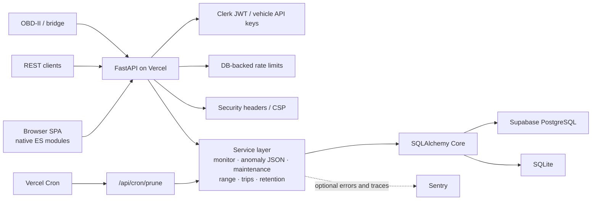

# Architecture

VitaDrive is a FastAPI service, a small browser SPA, and a SQLAlchemy Core data
store. The same application works with SQLite for local use and PostgreSQL for
deployed use.

## Request lifecycle

The dashboard and REST clients call the FastAPI application. Ingest clients
authenticate with a per-vehicle API key; owner-facing routes use Clerk session
JWTs when Clerk is configured. Requests receive a validated or generated
request ID. Security headers are applied to HTTP responses, and CORS is enabled
only when `CORS_ORIGINS` contains allowed origins. FastAPI exception handlers
turn HTTP, validation, rate-limit, and unhandled errors into a consistent JSON
error envelope; responses include `X-Request-ID` when available.

`create_app()` registers optional CORS, request-ID middleware, and security
headers. Starlette wraps later-added middleware outside earlier-added
middleware, so the effective inbound order is security headers, request ID,
optional CORS, and then FastAPI routing. The response unwinds through those
wrappers.

## Architecture diagram

The browser app is served from `vitadrive/static/` and calls the same API. The
bridge runs beside the vehicle, not in a serverless function, and sends
readings to the REST ingest endpoint.

## Ingest and trip flow

`POST /api/vehicles/{vin}/readings` checks that the VIN in the URL matches the
reading and that the vehicle API key is valid. Within the service transaction,
VitaDrive compares the incoming reading with the prior reading, updates or
creates a trip when the samples are no more than ten minutes apart and the
odometer advances by at least 0.05 km, stores the reading, then evaluates
thresholds and diagnostic trouble codes. Cleared sensor alerts are resolved
and duplicate open alerts are suppressed. The API returns newly raised alerts
and attempts Web Push delivery for new critical alerts; delivery failures do
not roll back ingestion.

Health reports combine the latest reading, current alerts, maintenance
forecasts, range estimation, and the learned anomaly score. The anomaly
detector loads trained weights from JSON and runs inference in plain Python;
PyTorch is only needed by the optional training script.

## Data model and migrations

SQLAlchemy Core tables live in `vitadrive/storage.py`; migration scripts are
under `vitadrive/migrations/versions/`. Most domain objects are serialized as
JSON in a `data` text column, with indexed columns for ownership, VINs, dates,
and query paths.

| Revision | Tables and purpose |
|---|---|
| `0001` | `vehicles`, `readings`, `alerts`, `services`, `fuel_logs`, and `push_subscriptions` |
| `0002` | `rate_limits`, shared request counters keyed by subject and time window |
| `0003` | `readings_daily`, compact UTC-day summaries for older sensor history |
| `0004` | `trips`, detected journeys and their odometer, level, speed, and sample data |

Vehicle-owned rows are removed with their vehicle. Trip records remain
independent of raw-reading retention, so compaction does not erase trip
history.

## Retention

`vitadrive prune` and the cron endpoint compact complete UTC days of readings
older than 30 days by default. A summary keeps the latest timestamp and
odometer, averages numeric sensor fields, combines diagnostic codes, and
records how many raw readings it represents. Queries merge raw readings with
these summaries. The same prune operation removes expired rate-limit windows;
it does not compact trips, alerts, services, or fuel logs.

## Authentication modes

- **Local mode:** if `CLERK_PUBLISHABLE_KEY` is unset, authentication is off
  and requests use the shared `local` owner. Use this only on a trusted local
  instance.
- **Clerk mode:** the dashboard sends a Clerk bearer session JWT. The API
  verifies its signature against Clerk's public JWKS, checks the issuer and
  required claims, and optionally checks the token's authorized party against
  `CLERK_AUTHORIZED_PARTIES`. Owner-facing routes are scoped to the Clerk
  subject.
- **Vehicle ingest:** each vehicle has a separately issued API key. Only its
  hash is stored, and the key is shown to the owner once when issued.

## Environment variables

Unset optional variables use the defaults shown. Do not commit secret values.

| Variable | Default or behavior | Purpose |
|---|---|---|
| `ASK_DAILY_QUOTA` | `50` | Maximum Ask VitaDrive questions per user per UTC day. |
| `CLERK_AUTHORIZED_PARTIES` | Empty (no origin allowlist) | Comma-separated origins accepted from the JWT `azp` claim. |
| `CLERK_JWKS_URL` | Derived from the publishable key | Optional override for Clerk's public signing-key endpoint. |
| `CLERK_PUBLISHABLE_KEY` | Unset (local auth-off mode) | Enables Clerk authentication and identifies its frontend API. |
| `CORS_ORIGINS` | Empty (CORS middleware disabled) | Comma-separated origins allowed to call the API cross-origin. |
| `CRON_SECRET` | Unset (cron endpoint disabled) | Bearer token required by `/api/cron/prune`. |
| `DATABASE_URL` | Checked before `VITADRIVE_DB` | SQLAlchemy database URL; required on Vercel. |
| `LOG_LEVEL` | `INFO` | Application log verbosity. |
| `OPENAI_API_KEY` | Unset (AI chat disabled) | Enables the optional Ask VitaDrive integration. |
| `OPENAI_MODEL` | `gpt-4o-mini` | OpenAI chat model used when Ask is enabled. |
| `SENTRY_DSN` | Unset (Sentry disabled) | Enables optional Sentry error reporting. |
| `SENTRY_TRACES_SAMPLE_RATE` | `0` | Sentry performance-trace sampling rate. |
| `VAPID_PRIVATE_KEY` | Unset (push disabled) | Private Web Push signing key; keep secret. |
| `VAPID_PUBLIC_KEY` | Unset (push disabled) | Public Web Push application-server key. |
| `VAPID_SUBJECT` | `mailto:alerts@vitadrive.app` | Contact URI included in VAPID claims. |
| `VERCEL` | Unset locally | Vercel marker; when set, a missing `DATABASE_URL` is an error. |
| `VERCEL_ENV` | `local` for Sentry | Deployment environment label attached to Sentry events. |
| `VITADRIVE_API_KEY` | Unset | Default bridge CLI API key; can also be supplied with `--api-key`. |
| `VITADRIVE_AUTO_MIGRATE` | Enabled | Set to `0` or `false` to disable startup migrations. |
| `VITADRIVE_DB` | `vitadrive.db` | Fallback database target when `DATABASE_URL` is unset. |
| `VITADRIVE_RATE_LIMITS` | Enabled | Set to `0` or `false` to disable request rate limiting. |

## Deployment

- **Vercel:** the root `app.py` exports the FastAPI application; Vercel serves
  the dashboard and API. Configure `DATABASE_URL` for a PostgreSQL database
  such as Supabase. Migrations run at startup unless disabled.
- **Scheduled retention:** `vercel.json` schedules `/api/cron/prune` daily at
  03:00 UTC. The endpoint is inactive unless `CRON_SECRET` is configured and
  requires `Authorization: Bearer <secret>`.
- **Supabase:** use its PostgreSQL connection string; the deployment guide
  recommends the transaction pooler for serverless connections.
- **Docker:** `docker compose` runs the app with a local PostgreSQL service.
  The database port is not published to the host.
- **SQLite:** the default local database is `vitadrive.db`; set `DATABASE_URL`
  or `VITADRIVE_DB` to use another path or supported SQLAlchemy URL.
- **Sentry:** optional error reporting and trace sampling are enabled through
  `SENTRY_DSN` and `SENTRY_TRACES_SAMPLE_RATE`.

See [deployment instructions](DEPLOY.md), the
[OBD bridge guide](obd-bridge.md), and the [decision records](adr/README.md).
